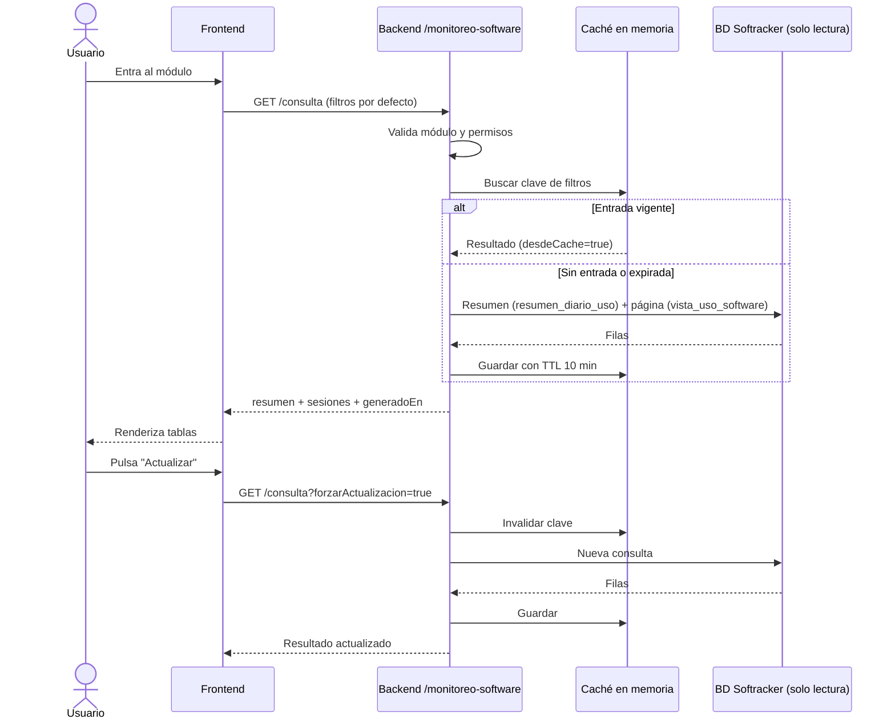

# Plan general de implementación — Monitoreo de uso de software (integración con Softracker)

Fecha base: 07/10/2026

Este plan cubre frontend y backend para incorporar al Sistema de Gestión Operativa de las Aulas de Software un módulo que consulte, en solo lectura, la base de datos de Softracker y muestre y exporte las sesiones y horas de uso de software académico por aula.

El módulo representa el **uso real del software**. No reemplaza el catálogo `Software` ni el inventario de programas instalados (`AulaSoftware`), y no escribe en la base de Softracker. Depende del plan `c:\Users\ud\Documents\Softracker\PLAN_FILTRO_SOFTWARE_ACADEMICO.md`, que crea la base, las vistas y el rol de solo lectura.

---

## 0. Objetivo y alcance

El módulo deberá permitir:

- consultar un resumen de horas de uso por aula, software y categoría;
- consultar un listado paginado de sesiones de uso;
- filtrar por rango de fechas, aula, software, categoría y equipo;
- exportar a CSV y Excel el resultado filtrado;
- mostrar la fecha y hora de los datos consultados;
- controlar el acceso mediante módulo y permisos.

Fuera del alcance inicial:

- escribir en la base de datos de Softracker;
- actualizar datos en tiempo real o mediante consultas periódicas;
- incorporar librerías de gráficos (se usarán tablas y, si se desea, barras simples con CSS);
- vincular automáticamente el uso con `AulaSoftware` (posible evolución: comparar software instalado frente a software usado);
- administrar el catálogo académico, que se gestiona en Softracker.

---

## 1. Reglas generales

- [ ] Implementar el módulo NestJS en `backend/src/monitoreo-software`.
- [ ] Usar una conexión independiente de `PrismaService`, mediante `pg.Pool` y el rol `softracker_readonly`.
- [ ] Usar exclusivamente SQL parametrizado.
- [ ] Leer únicamente `vista_uso_software`, `resumen_diario_uso` y `software_catalogo`.
- [ ] Crear un controller propio; no agregar rutas a `reportes.controller.ts`, que tiene la ruta comodín `@Get(':reporte')`.
- [ ] Reutilizar guards globales, decoradores `@RequireModule`/`@RequirePermissions`, `HttpExceptionFilter` y `ValidationPipe`.
- [ ] Si la base de Softracker no está disponible, responder 503 con un mensaje claro sin afectar el resto del sistema.
- [ ] No agregar consultas periódicas (`setInterval`) en el frontend.
- [ ] Mantener sincronizados `MODULOS` y la lista `modulos` del seed al registrar el módulo.
- [ ] Registrar el módulo en `backend/src/MODULES.md`.

---

## 2. Conexión con Softracker

### 2.1 Módulo de conexión

Crear `backend/src/softracker-db/softracker-db.module.ts` (global) y `softracker-db.service.ts`:

- `pg.Pool` con `max: 5`, `idleTimeoutMillis: 30000`, `connectionTimeoutMillis: 5000`, `statement_timeout: 10000` y `application_name: 'gestion-aulas'`;
- método `consultar<T>(sql: string, params: unknown[]): Promise<T[]>`;
- cierre del pool en `onModuleDestroy`;
- conexión perezosa: el arranque del backend no falla si Softracker está caído;
- traducción de errores de conexión y de tiempo de espera a `ServiceUnavailableException`.

### 2.2 Configuración

Agregar la variable `SOFTRACKER_DATABASE_URL` en:

- `backend/.env.example` (solo el formato, sin valores reales);
- bloque `environment` del servicio `backend` en `backend/docker-compose.yml`;
- `src/config/environment.ts` con `requiredInProduction`, y su prueba en `environment.spec.ts`;
- `scripts/validate-docker-env.cjs` (`deploy:preflight`).

Formato:

```text
postgresql://softracker_readonly:<clave>@<host>:<puerto>/<base>
```

Conectividad: usar `host.docker.internal`, ya configurado en `extra_hosts` del backend, o una red Docker externa compartida con Softracker. Si ambos sistemas quedan en servidores distintos, exigir túnel o VPN y TLS.

---

## 3. Permisos

- Agregar `MONITOREO_SOFTWARE: 'MONITOREO_SOFTWARE'` a `MODULOS` en `src/auth/auth.constants.ts`.
- En `prisma/seed.ts`, agregar el módulo a `modulos` y `MONITOREO_SOFTWARE: ['LEER', 'EXPORTAR']` a `accionesPorModulo`.
- Crear una migración Prisma de datos que inserte el módulo y los permisos y los asigne al rol administrador, siguiendo `20261006170000_installation_permissions_and_dashboard_dismissals`.

Permisos:

- `MONITOREO_SOFTWARE_LEER`;
- `MONITOREO_SOFTWARE_EXPORTAR`.

La visibilidad del frontend debe acompañar estos permisos, pero no sustituir su validación en la API.

---

## 4. Backend NestJS

### 4.1 Responsabilidades internas

- `MonitoreoSoftwareController`: contratos HTTP y permisos.
- `MonitoreoSoftwareService`: construcción de consultas, resumen, listado y enriquecimiento con aulas locales.
- `MonitoreoSoftwareCacheService`: caché en memoria con TTL (sección 5).
- `ExportacionMonitoreoService`: generación de CSV y Excel.
- DTOs: `ConsultarMonitoreoDto` y `ExportarMonitoreoDto`.

### 4.2 Contratos REST propuestos

```text
GET /monitoreo-software/consulta         resumen + primera página en una sola respuesta
GET /monitoreo-software/sesiones         solo una página de sesiones (cambio de página)
GET /monitoreo-software/filtros          aulas, software y categorías disponibles
GET /monitoreo-software/exportar/csv     resultado filtrado en CSV
GET /monitoreo-software/exportar/excel   resultado filtrado en Excel
```

### 4.3 Filtros

`ConsultarMonitoreoDto`:

- `desde` y `hasta` (`IsDateString`); por defecto, los últimos 30 días; rango máximo de 366 días; `desde` no puede ser posterior a `hasta`;
- `aula` opcional, con formato `^\d{3}$`;
- `softwareId` opcional;
- `categoria` opcional;
- `hostname` opcional;
- `pagina` (mínimo 1);
- `limite` (entre 1 y 200, por defecto 50);
- `orden` limitado a una lista blanca de columnas;
- `forzarActualizacion` opcional (booleano).

### 4.4 Respuesta de consulta

```text
{
  resumen: {
    totalMinutos, totalSesiones,
    porSoftware[], porAula[], porCategoria[]
  },
  sesiones: { items[], total, pagina, limite },
  generadoEn,
  desdeCache
}
```

- El resumen se obtiene de `resumen_diario_uso`, sin recorrer las sesiones.
- El listado usa `vista_uso_software` con `LIMIT`/`OFFSET` y el total con `count(*) OVER()` o una consulta de conteo filtrada.
- La ubicación de cada aula se obtiene de `Aula` local en una sola consulta `findMany({ where: { codigo: { in: codigos } } })`.
- Las aulas sin registro local se muestran con su código y la marca "sin registro en Gestión de Aulas".

### 4.5 Exportación

- Mismos filtros que la consulta, sin usar la caché.
- Tope de 100 000 filas. Si se supera, responder 422 con un mensaje que pida acotar el rango.
- Excel con hojas `Resumen` y `Sesiones`, generado con la librería `xlsx` existente.
- Nombre `Monitoreo_Software_<desde>_<hasta>.xlsx` (y `.csv`).
- Columnas en español y fechas en hora de Bogotá.
- Cabeceras `Content-Type`, `Content-Disposition` y `Content-Length` según el patrón de `reportes.controller.ts`.
- Requiere `MONITOREO_SOFTWARE_EXPORTAR`.

---

## 5. Optimización y control de consultas

Los agentes envían los datos una vez al día, a las 21:45. Consultar con más frecuencia no aporta datos nuevos y solo genera carga en ambas bases. Por eso el módulo consulta solo cuando el usuario lo pide y reutiliza resultados recientes.

### 5.1 Frontend

- No usar `setInterval` ni consultas periódicas. Las vistas `DashboardView`, `AvailabilityView`, `ScheduleView`, `TasksView`, `CampanaNotificaciones` y `ReportesApiView` consultan cada 30 a 60 segundos y no deben tomarse como modelo.
- Consultar solo en estos casos:
  - al entrar al módulo;
  - al pulsar "Aplicar filtros";
  - al cambiar de página (solo `/sesiones`);
  - al pulsar "Actualizar" (con `forzarActualizacion=true`).
- Los filtros se editan en estado local y no disparan consultas mientras se escriben.
- Al entrar se hace una sola petición a `/consulta`, en lugar de una por bloque.
- `/filtros` se consulta una vez por visita y se guarda en el estado del componente.
- Usar `AbortController` para cancelar la petición anterior y al desmontar la vista.
- Deshabilitar los botones mientras hay una petición en curso.
- No recargar al volver a enfocar la pestaña.
- Mostrar "Datos actualizados a las hh:mm" con `generadoEn` e indicar si provienen de caché.
- Mantener los filtros en la URL (`searchParams`), para que recargar o compartir el enlace reproduzca la consulta sin peticiones adicionales.

### 5.2 Backend

`MonitoreoSoftwareCacheService` copia el patrón de `src/panel-operativo/panel-operativo.service.ts`:

- `Map<string, { expiraEn: number; valor: Promise<T> }>`;
- se guarda la Promise, de modo que peticiones idénticas simultáneas comparten una sola consulta;
- la entrada se borra si la consulta falla;
- TTL de 10 minutos para `/consulta` y `/sesiones`, y de 1 hora para `/filtros`;
- clave formada por los filtros normalizados (fechas ISO, aula, software, categoría, equipo, orden, página y límite);
- la clave no incluye al usuario, porque los datos no dependen de él; los permisos se validan antes de leer la caché;
- `forzarActualizacion` invalida la clave y vuelve a consultar;
- máximo de 100 entradas: primero se purgan las expiradas y luego las menos usadas;
- la caché es local a cada instancia; si en el futuro hay varias instancias, evaluar Redis.

### 5.3 Base de datos

- El resumen proviene de la vista materializada `resumen_diario_uso`.
- Se aprovechan los índices `(sala_codigo, inicio)` y `(software_id, inicio)` definidos en el plan de Softracker.
- El rango de fechas es obligatorio y acotado.
- `statement_timeout` de 10 segundos y pool de máximo 5 conexiones.
- Se seleccionan solo las columnas necesarias.

### 5.4 Flujo



---

## 6. Frontend

### 6.1 Ruta y navegación

- Página fina en `src/app/(operacion)/monitoreo-software/page.tsx` que renderiza la vista.
- Entrada "Monitoreo de software" en `src/config/navigation.ts`.
- `"/monitoreo-software": "MONITOREO_SOFTWARE"` en `moduleByRoute` de `src/components/layout/AppShell.tsx`.

Antes de escribir código, leer la guía en `node_modules/next/dist/docs/`, como exige `Frontend/AGENTS.md`.

### 6.2 Estructura

```text
src/features/monitoreo-software/
  api/monitoreoSoftwareApi.ts
  components/MonitoreoSoftwareView.tsx
  components/MonitoreoSoftwareView.module.css
  types.ts
```

`monitoreoSoftwareApi.ts` usa `solicitarAulas` y `descargarAulas` (`src/features/monitores/api/clienteMonitores.ts`) con el token de `obtenerSesion()`.

### 6.3 Vista principal

- indicadores: horas totales, sesiones, software más usado y aula con más uso;
- tablas de resumen por software y por aula;
- tabla de sesiones paginada;
- filtros con botón "Aplicar filtros" y botón "Actualizar";
- botones "Exportar CSV" y "Exportar Excel", visibles con `tienePermiso('MONITOREO_SOFTWARE_EXPORTAR')`;
- texto "Datos actualizados a las hh:mm";
- estados de carga, vacío, error y "Softracker no disponible";
- modo claro, oscuro y diseño responsive;
- accesibilidad: `label` en cada filtro, `<caption>` y `scope` en las tablas, `aria-busy` durante la carga y `aria-live` para los avisos.

---

## 7. Hallazgos de la revisión del código actual

Riesgos detectados en la revisión de solo lectura de la rama `gestion-monitores`. Quedan fuera del alcance del módulo, pero conviene atenderlos:

- el cambio de `postgres:16-alpine` a `postgres:18-alpine` en `backend/docker-compose.yml` usa el mismo volumen `reportes_postgres_data`; Postgres no arranca con datos de otra versión mayor sin `pg_dump` y restauración;
- hay dumps de base de datos en `TransferenciaCosmos/` y documentos PDF y Excel con datos personales versionados en el repositorio;
- la lista `modulos` del seed (19 entradas, con `ADMINISTRACION` y `MONITORES`) no coincide con `MODULOS` (17 entradas);
- la ruta comodín `@Get(':reporte')` de `reportes.controller.ts` captura cualquier ruta nueva declarada después de ella;
- en la revisión no se ejecutaron el build ni las pruebas, por lo que su estado actual no está verificado.

---

## 8. Entrega por incrementos

### Incremento 1 — Conexión y permisos

- [ ] Crear `SoftrackerDbModule` y `SoftrackerDbService`.
- [ ] Agregar `SOFTRACKER_DATABASE_URL` en entorno, validación, compose y preflight.
- [ ] Registrar `MONITOREO_SOFTWARE` en `MODULOS`, seed y migración de permisos.
- [ ] Implementar `GET /monitoreo-software/filtros`.
- [ ] Demo: `/filtros` responde con datos reales; un usuario sin el módulo recibe 403.

### Incremento 2 — Consulta optimizada

- [ ] Implementar `ConsultarMonitoreoDto` con sus validaciones.
- [ ] Implementar `/consulta` y `/sesiones`.
- [ ] Implementar `MonitoreoSoftwareCacheService` con TTL y `forzarActualizacion`.
- [ ] Enriquecer con aulas locales.
- [ ] Demo: una segunda petición idéntica sale de caché (`desdeCache: true`) y el log muestra una sola consulta a Softracker.

### Incremento 3 — Exportación

- [ ] Implementar CSV y Excel con tope de filas.
- [ ] Validar el permiso de exportación.
- [ ] Demo: descarga y apertura del Excel con las hojas `Resumen` y `Sesiones`.

### Incremento 4 — Frontend

- [ ] Crear ruta, navegación y `moduleByRoute`.
- [ ] Construir la vista con filtros en la URL y sin consultas periódicas.
- [ ] Implementar estados de carga, vacío, error y no disponible.
- [ ] Demo: al entrar al módulo, la pestaña Red del navegador muestra una llamada a `/consulta` y una a `/filtros`; filtrar y paginar solo consulta cuando se pide.

### Incremento 5 — Calidad y cierre

- [ ] Validar permisos con perfiles distintos.
- [ ] Verificar la respuesta 503 controlada con Softracker caído.
- [ ] Revisar modo claro, oscuro, diseño responsive y accesibilidad.
- [ ] Documentar el módulo en `backend/src/MODULES.md` y en el documento general.

---

## 9. Pruebas mínimas

### Backend

- [ ] DTO: rango por defecto, máximo de 366 días, `desde` posterior a `hasta`, aula inválida y límite mayor a 200.
- [ ] Consultas siempre parametrizadas.
- [ ] Caché: acierto, expiración, deduplicación de peticiones simultáneas, `forzarActualizacion`, borrado al fallar y purga.
- [ ] E2E en `backend/test/monitoreo-software.e2e-spec.ts` con pool simulado o base de prueba:
  - [ ] 200 con permiso;
  - [ ] 403 sin el módulo;
  - [ ] 403 al exportar sin `MONITOREO_SOFTWARE_EXPORTAR`;
  - [ ] 503 con Softracker caído;
  - [ ] cabeceras correctas de CSV y Excel;
  - [ ] 422 al superar el tope de exportación.

### Frontend

- [ ] `npm run lint` y `npm run build` sin errores.
- [ ] Prueba manual: no hay peticiones periódicas.
- [ ] Prueba manual: entrar al módulo genera una llamada a `/consulta` y una a `/filtros`.
- [ ] Filtros en la URL reproducen la consulta al recargar.
- [ ] Estados de carga, vacío, error y no disponible.

### Flujo E2E principal

```text
Agente envía Parquet
→ servidor Softracker filtra y guarda sesiones
→ usuario entra al módulo
→ consulta (caché o base de Softracker)
→ aplica filtros y pagina
→ exporta CSV o Excel
```

---

## 10. Criterio de cierre

El módulo se considera terminado cuando:

- la conexión a Softracker funciona en solo lectura con el rol `softracker_readonly`;
- el resumen y el listado muestran datos reales con los filtros definidos;
- la caché evita consultas repetidas y `forzarActualizacion` las renueva;
- el frontend consulta solo por acción del usuario;
- la exportación CSV y Excel respeta filtros, tope y permisos;
- una caída de Softracker produce un 503 controlado sin afectar otros módulos;
- los permisos se validan en frontend y backend;
- las pruebas unitarias, E2E, TypeScript y compilaciones finalizan correctamente;
- el módulo queda documentado en el documento general y en el mapa técnico del proyecto.

---

## 11. Orden recomendado

1. Completar en Softracker al menos la vista `vista_uso_software`, `resumen_diario_uso` y el rol `softracker_readonly`.
2. Implementar la conexión y los permisos.
3. Implementar la consulta con caché.
4. Implementar la exportación.
5. Construir el frontend.
6. Cerrar calidad, permisos y documentación.

Este orden asegura que la interfaz se construya sobre datos reales y que la caché esté disponible antes de que el frontend empiece a generar consultas.
